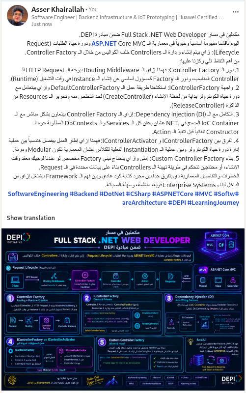
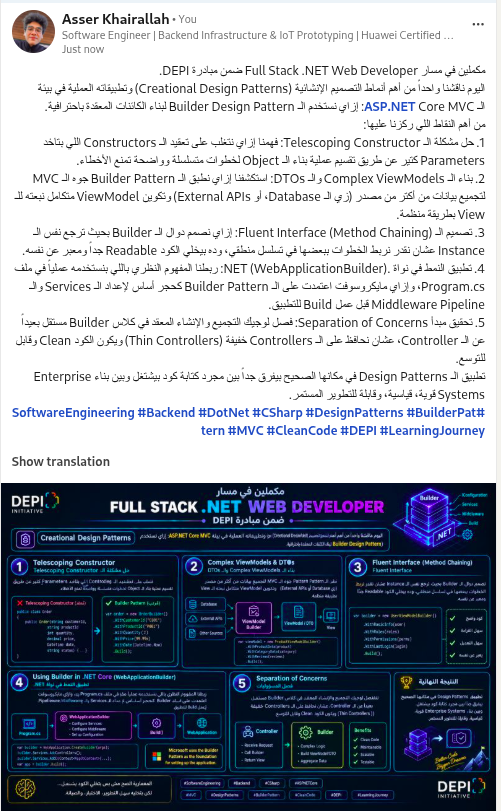
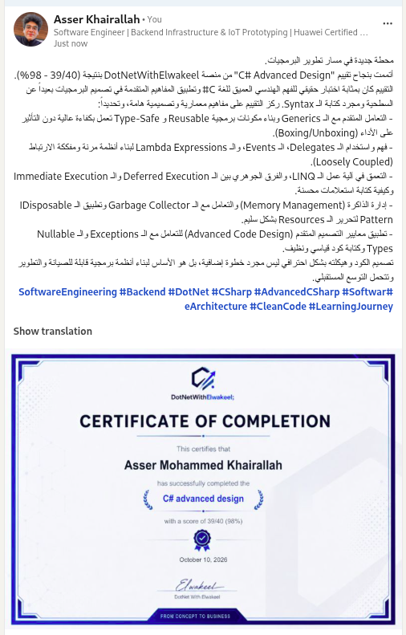

# ASP.NET Core MVC & Entity Framework Core 8.0 Assignment - DEPI

### 1. Practical Code (`SchoolApp`)
The solution includes a complete ASP.NET Core MVC application (`SchoolApp`) targeting .NET 8.0 and Entity Framework Core 8.0 demonstrating:
- Code-First database modeling (`Department`, `Student`, `Course`, `Teacher`, and `StuCrsRes` junction table).
- One-to-Many and Many-to-Many relationships configured via Fluent API (`OnModelCreating`) with composite primary keys and restricted cascade delete behaviors.
- Dependency Injection setup for `SchoolDbContext` using SQL Server.
- `StudentController` actions and Razor Views for displaying all students (`/Student/ShowAll`) and specific student details by ID (`/Student/ShowDetails?id=3`).

### 2. LinkedIn Articles & Certificate Posts

- **Post 1: Controller Factory in ASP.NET Core MVC**
  [View Post on LinkedIn](https://lnkd.in/p/ekWVvRwC)
  

- **Post 2: Builder Design Pattern in ASP.NET Core MVC**
  [View Post on LinkedIn](https://lnkd.in/p/eUM_v2Ve)
  

- **Post 3: C# Advanced Design Certificate (DotNetWithElwakeel)**
  [View Post on LinkedIn](https://lnkd.in/p/efBmtVnx)
  
